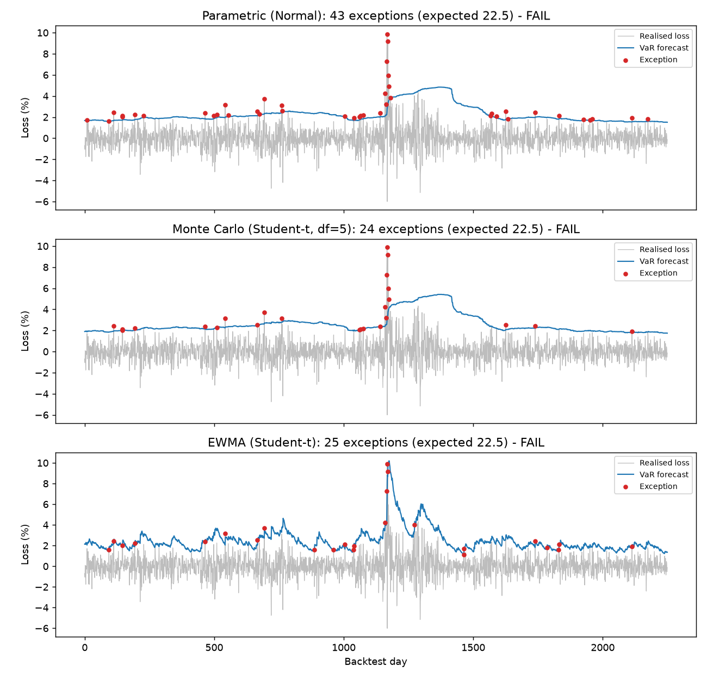

# Monte Carlo Portfolio Risk Engine

A small, tested Python library that estimates **Value-at-Risk (VaR)** and **Expected Shortfall (CVaR)** for a portfolio using several methods, then **backtests each one with formal statistical tests** to see which models can actually be trusted.



## What it does

| Component | Details |
|---|---|
| **Estimators** | Historical simulation, parametric (variance-covariance), Monte Carlo with multivariate Normal, Monte Carlo with multivariate Student-t, EWMA (RiskMetrics) volatility variants |
| **Monte Carlo** | Correlated scenarios via Cholesky decomposition; Student-t rescaled so its covariance matches the Normal model (fair comparison); optional antithetic variates |
| **Risk attribution** | Component VaR (Euler allocation): which asset contributes how much of the portfolio risk |
| **Backtesting** | Rolling-window VaR forecasts with no lookahead, **Kupiec** (exception count) and **Christoffersen** (exception clustering) tests |
| **Data** | Synthetic generator (GARCH volatility clustering + fat-tailed shocks) or your own price CSV |

## Quick start

```bash
git clone https://github.com/ratul-codes/mc-risk-engine.git
cd mc-risk-engine
python -m venv .venv && source .venv/bin/activate   # Windows: .venv\Scripts\activate
pip install -r requirements.txt
python -m mcrisk            # full demo (about 30-60 seconds)
pytest                      # test suite
python -m mcrisk.study      # multi-dataset robustness study (about 3 minutes)
```

Use real data: `python -m mcrisk --csv prices.csv` (first column = date, one column per asset).

## Results (synthetic data, 2,500 days, 8 assets, equal weights, 99% one-day)

**Full-sample estimates**

| Method | VaR | CVaR |
|---|---|---|
| Historical | 2.88% | 4.28% |
| Parametric (Normal) | 2.33% | 2.67% |
| Monte Carlo (Normal) | 2.31% | 2.64% |
| Monte Carlo (Student-t, df=5) | 2.61% | 3.42% |
| EWMA (Normal) | 1.14% | 1.30% |
| EWMA (Student-t) | 1.27% | 1.69% |

The EWMA rows weight recent days heavily (effective memory about 16 days), so they describe risk *now*, at the end of the sample, which happens to be calm. They are not comparable with the full-sample rows above them.

**Rolling backtest** (250-day window, 2,250 forecasts, 22.5 exceptions expected)

| Method | Exceptions | Kupiec p | Christoffersen p | Verdict |
|---|---|---|---|---|
| Historical | 31 | 0.088 | 0.074 | PASS |
| Parametric (Normal) | 43 | 0.000 | 0.260 | FAIL |
| Monte Carlo (Normal) | 44 | 0.000 | 0.283 | FAIL |
| Monte Carlo (Student-t) | 24 | 0.753 | 0.025 | FAIL |
| EWMA (Normal) | 45 | 0.000 | 0.002 | FAIL |
| EWMA (Student-t) | 25 | 0.603 | 0.000 | FAIL |

### What the results say

1. **Normal-based models underestimate tail risk.** They breach their 99% VaR almost twice as often as promised (43-44 vs 22.5 expected), and Kupiec rejects them decisively. The two Normal models agree with each other, so the problem is the *distribution assumption*, not the Monte Carlo machinery.
2. **Fat tails fix the exception count but not the timing.** Student-t gets the number of exceptions right (24 vs 22.5, Kupiec p = 0.75) but fails Christoffersen: its exceptions cluster during the volatility spike (see chart). A 250-day window reacts too slowly when volatility jumps.
3. **Historical simulation passes narrowly** on this sample, but it is noisy and has no model of its own tail, so its result is not a strong guarantee.
4. **EWMA did not fix the clustering on this one dataset** (Christoffersen p < 0.001), which I did not expect. The cause is small numbers: EWMA-t had 4 back-to-back exception pairs against 2 for equal-weight Student-t, out of only ~25 exceptions in total. One backtest is one random draw, so see the next section before drawing conclusions.

### Is that result typical? Robustness across 45 datasets

`python -m mcrisk.study` repeats the backtest on 45 independent synthetic datasets (2,250 forecasts each, 5% significance level) and counts how often each method passes:

| Method | Avg exceptions (22.5 expected) | Kupiec pass | Christoffersen pass | Both pass |
|---|---|---|---|---|
| Historical | 34.8 | 27% | 84% | 24% |
| Parametric (Normal) | 40.6 | 9% | 78% | 4% |
| MC Student-t | 33.0 | 44% | 80% | 42% |
| EWMA Normal (0.94) | 36.6 | 16% | 98% | 16% |
| EWMA Student-t (0.94) | 29.3 | 82% | 96% | 78% |
| EWMA Student-t (0.97) | 26.6 | 89% | 91% | 82% |

**What this shows**

- **Each fix addresses a different failure.** Fat tails (Student-t) fix the *count* of exceptions; EWMA fixes the *timing*. EWMA with Normal shocks passes the clustering test almost always (98%) but still has too many exceptions, because a Normal distribution underestimates tails. Only the combination passes both tests most of the time (78-82%).
- **The single-dataset EWMA failure was mostly bad luck**, since across datasets the clustering test passes 96% of the time.
- **Nothing is perfectly calibrated.** A correct model would pass each test about 95% of the time, and the best methods still average 27-29 exceptions against 22.5 expected.
- **Lambda was not tuned in advance.** I tried 0.94 (the RiskMetrics default) first, then looked at 0.97 after seeing the results, so treat 0.97 as a sensitivity check, not a tuned optimum.
- **Caveats:** with 45 datasets each pass rate has a standard error of roughly 6-7 percentage points, so the 78% vs 82% gap between the two lambdas is within noise, and the synthetic data is itself generated by a GARCH process, which favours volatility-adaptive models. Real data may behave differently.

### Monte Carlo convergence

Standard error of the VaR estimate (100 seeds each) shrinks at roughly the expected 1/sqrt(N) rate:

| Paths | Plain SE | Antithetic SE |
|---|---|---|
| 1,000 | 0.110% | 0.110% |
| 10,000 | 0.044% | 0.041% |
| 100,000 | 0.012% | 0.013% |

Antithetic variates give **no meaningful gain here**. That makes sense: they cancel noise in *averages* of symmetric functions, but VaR is a *tail quantile*, which they do not help much. I kept the option in and reported the null result rather than claiming a benefit.

## Design decisions

- **Losses are positive numbers** (0.025 = a 2.5% loss) so "VaR is the alpha-quantile of losses".
- **No lookahead:** the forecast for day *t* uses only days *t-window ... t-1* (covered by a unit test).
- **Student-t is rescaled** by sqrt((df-2)/df) so its covariance equals the Normal model's. Differences in results come from tail shape only.
- **Estimators share one signature** `f(returns, weights, alpha) -> RiskEstimate`, so new methods plug into the backtester without changes.
- **Tests compare against closed-form answers** (e.g. Normal VaR = sigma * z), check seed reproducibility, covariance recovery, and input validation.

## Limitations

- Results use **synthetic data**; run `--csv` on real prices before drawing conclusions about real markets.
- Student-t degrees of freedom is fixed at 5, not estimated.
- EWMA's decay (lambda = 0.94 / 0.97) is fixed rather than estimated, and the study's synthetic data is GARCH-generated, which favours adaptive volatility models.
- One-day horizon, linear equity-like portfolio (no options or non-linear payoffs), simple returns.
- Statistical power is limited: 2,250 observations at 99% gives only about 22 expected exceptions.

## What I'd do next

1. Fit a full **GARCH(1,1)** model and compare it with EWMA (lambda is fixed here, not estimated).
2. **Filtered historical simulation** (standardize by volatility, resample, rescale).
3. Estimate Student-t degrees of freedom by maximum likelihood.
4. Add **stress scenarios** (correlation to 1, 2x volatility).
5. Run on real multi-asset data (e.g. 2008 and 2020 crises) and compare.

## Project layout

```
mcrisk/
  models.py     VaR/CVaR estimators, Monte Carlo simulation, component VaR
  backtest.py   rolling backtest, Kupiec and Christoffersen tests
  ewma.py       EWMA covariance and VaR estimators
  study.py      multi-dataset robustness study
  data.py       synthetic data generator and CSV loader
  plots.py      charts
  __main__.py   command-line demo
tests/          pytest suite (22 tests)
docs/           generated charts and results.txt
```

## License

MIT
